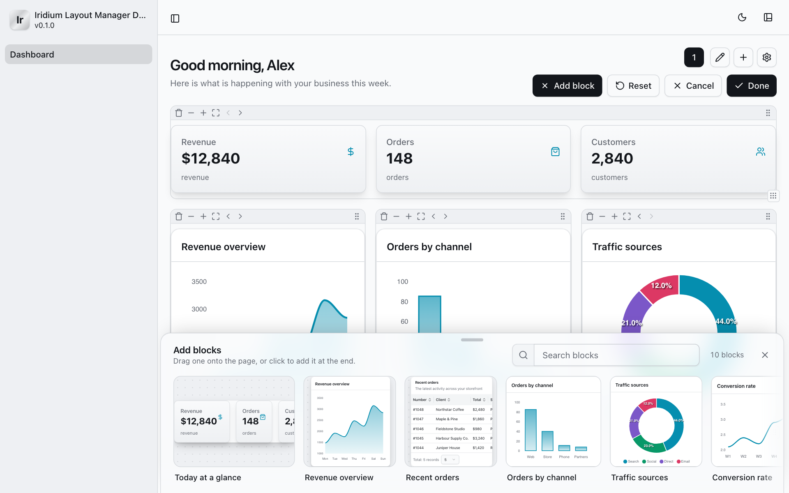
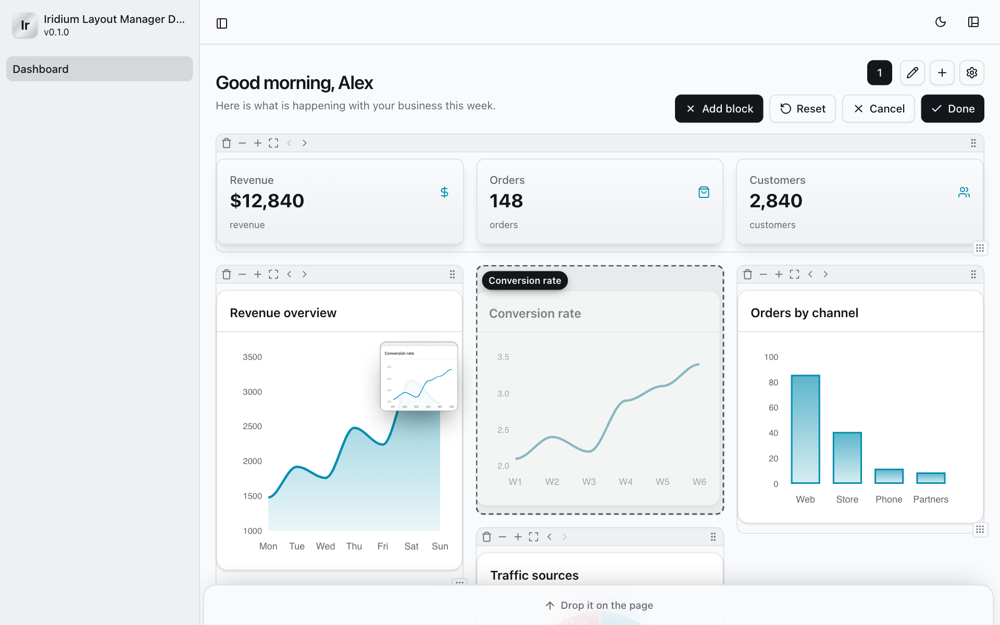
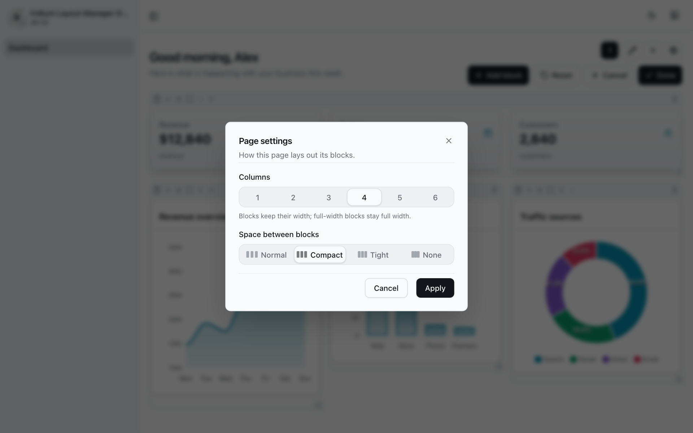

# Iridium Layout Manager

A standalone plugin for [Iridium](https://github.com/goiridium/iridium) that
lets your end-users arrange their own dashboard pages: pick blocks (Iridium
widgets or arbitrary `templ` components) from a gallery of live previews,
drag them onto the page, drag-to-reorder, resize their column span, and
commit the result. Layouts are kept on the server per user, with hooks to
store committed layouts in your own database.



Ported from the [FilamentPHP Filament Layout Manager](https://github.com/asosick/filament-layout-manager)
plugin to Iridium's HTMX + Alpine + templ stack.

Drag-to-reorder is powered by the Alpine Sort plugin that Iridium already bundles.

This plugin can serve as a starting point for understanding how to build your own Iridium plugin.
The beauty of Go is its duck typing lets you mix and match your custom code into Iridium fairly easily.

## Install

```bash
go get github.com/asosick/iridium_layout_manager@latest
```

## Quick start

```go
package main

import (
    "github.com/goiridium/iridium/core/panel"
    "github.com/goiridium/iridium/core/widget/stats"

    layoutmgr "github.com/asosick/iridium_layout_manager"
    "myapp/dashboard/components" // your own templ components
)

func main() {
    salesStats := stats.New("sales-stats").
        SetName("Sales Today")
        // ... configure stats ...

    dashboard := layoutmgr.NewLayoutManagerPage("Dashboard", "dashboard").
        Blocks(
            layoutmgr.StaticBlock("welcome", "Welcome banner", components.Welcome()),
            layoutmgr.DynamicBlock("greeting", "Personal greeting",
                func(w http.ResponseWriter, r *http.Request) templ.Component {
                    return components.Hello(r) // can read the current user
                },
            ),
            layoutmgr.WidgetBlock("salesStats", "Sales stats", salesStats),
        ).
        GridColumns(3)

    p := panel.New("/admin").Pages(dashboard)
    // ... mount the panel as usual ...
}
```

That's it. Visit the page, click **🔒 Edit**, then **+ Add block**: a gallery
slides up from the bottom with a live preview of every block. Drag a card onto
the grid to place its block there, or click it to add it at the end. Drag the
`⠿` handle or use the left/right buttons to reorder. Resize with the corner handle or the size
buttons, and use `×` to remove. **Done** commits and locks the arrangement;
**Reset** returns to the last committed arrangement and keeps editing;
**Cancel** does the same and locks.

Edits are a draft until Done: they survive a reload and come back when the
user edits again, while view mode always shows the committed arrangement.

Blocks flow in order, left to right and top to bottom, each spanning as many
small rows as its content needs (masonry), so a tall widget does not force
unrelated shorter widgets to leave an empty row beneath them, and the order on
screen is the order stored. Under 32rem of width the grid becomes one column.

## Block kinds

| Adapter | Use when |
|---|---|
| `StaticBlock(key, label, c)` | Tile is a fixed `templ.Component` (no per-request data). |
| `DynamicBlock(key, label, fn)` | Tile needs the `(w, r)` (DB queries, current user, etc.). |
| `WidgetBlock(key, label, w)` | Tile is an existing Iridium widget (chart, stats, form, table). |

You can mix them freely in a single `Blocks(...)` call.

### The block gallery

**+ Add block** opens a sheet at the bottom of the window with a card for
every block on offer, in one row that scrolls sideways (a mouse wheel scrolls
it too). The search field filters the cards by name: every word typed must
appear, Enter adds the first match, Escape clears the search and then closes
the sheet. Left and Right move between cards, and Enter or a click adds the
card's block after the last.

Each card is a live preview of its block. The server renders the block
(`GET /lm/preview?type=…`), laid out as wide as a placed block, and the card
scales the whole of it down with a CSS transform: a block needs no styles of
its own to preview, and a chart or a table looks as it will on the page. The
previews of the first cards start loading as soon as the page is being
edited, and the rest as they scroll into view; each stays behind a
placeholder until its block has drawn itself, then fades in. A preview is
inert: nothing in it takes focus or clicks.



Drag a card onto the grid and the sheet steps down to a strip, the grid opens
a slot where the block will land (the block itself, faded, at the size it will
be placed), and the blocks around it slide aside. Release to place it there;
release over the strip or away from the grid, or press Escape, and nothing is
added. Near the top or bottom of the page the page scrolls. On a touch screen,
drag a card upwards to lift it; sideways, the row scrolls.

A preview renders the block with a front-end ID of its own, so it never
clashes with a placed copy, and it is a render like any other: a heavy block
(a camera feed, a slow query) can draw something lighter in the gallery.
`layoutmgr.IsPreview(r)` reports a preview render, to a `DynamicBlock`
through its request and to an Iridium widget through its context's:

```go
layoutmgr.DynamicBlock("cam:"+cam.ID, cam.Name, func(w http.ResponseWriter, r *http.Request) templ.Component {
    if layoutmgr.IsPreview(r) {
        return cameraStill(cam) // not the live stream
    }
    return cameraStream(cam)
})

chart.New[*ctxWidget.Widget]("traffic").
    ChartDataFn(func(ctx *ctxWidget.Widget) map[string]any {
        if layoutmgr.IsPreview(ctx.GetRequest()) {
            return sampleTraffic // no query for the gallery
        }
        return queryTraffic(ctx.GetRequest())
    })
```

### Blocks that come and go

When the blocks on offer change while the app runs (one per camera, channel
or database record), give the page a `BlockSource` as well. It is asked on
every request, and its blocks are offered after the static ones:

```go
layoutmgr.NewLayoutManagerPage("Wall", "wall").
    BlockSource(func(r *http.Request) []layoutmgr.BlockSpec {
        var out []layoutmgr.BlockSpec
        for _, cam := range cameras.All() {
            out = append(out, layoutmgr.DynamicBlock("cam:"+cam.ID, cam.Name, cameraTile(cam)))
        }
        return out
    })
```

Source blocks register no routes, so keep a `WidgetBlock` whose widget has
routes in `Blocks`. A placed block whose key the source stops returning
renders as a missing block. Each placed instance's render request carries its
block ID (`ctxkeys.FEIDOverride`), so a block can keep settings per instance.

## Configuration

```go
layoutmgr.NewLayoutManagerPage("Dashboard", "dashboard").
    Blocks(...).
    GridColumns(3).            // 1..N column grid
    LayoutCount(3).            // fix the number of pages (default: users add their own)
    RenamablePages(true).      // users can name their pages (default true)
    Heading("My Dashboard").   // override the H1
    CompactVerticalPadding().  // Iridium's tighter page spacing (or NoVerticalPadding)
    Settings().                // users choose each page's columns and spacing
    MaxColumns(8).             // the most columns they can choose (default 6)
    AlignToolbarRight().       // with no title, the toolbar on the right
    ShowLockButton(true).      // hide to keep the page permanently editable
    Reorderable(true).         // enable drag-to-reorder
    Resizable(true).           // enable resize controls
    SaveHook(myDBSave).        // optional — persist to DB when Done is clicked
    LoadHook(myDBLoad)         // optional — read the committed layout from DB
```

The toolbar (the page buttons, then Edit, or the edit controls) sits in the
page header, at the right beside the title. When it wraps onto two rows, both
keep to the right edge. A page with no title (`Title("")`, and no description)
gives the toolbar the whole header, at the left as an Iridium page's actions
are, or at the right with `AlignToolbarRight()`.

### Multiple pages

Each user arranges one or more pages independently. Buttons at the top switch
between them, and the keys `1`..`9` jump straight to a page (not while typing
in a field, and not with Ctrl/Cmd, which the browser uses to switch tabs). The
page shown is kept in the address (`?layout=N`), so a reload stays on it. In
edit mode every page is shown so you can populate empty ones; in view mode only
pages that actually contain blocks show (and the strip hides entirely when only
one page is in use). All pages persist together in a single `LayoutState`.

By default users decide how many pages they have: they start with one, and in
edit mode **+** adds a page after the last and shows it, and the bin removes
the page shown with its blocks (after asking, if it has any). `LayoutCount(n)`
fixes the number of pages instead: every user has `n`, and there is no **+** or
bin.

A page's button shows its name, or its number when it has none. In edit mode
the pencil (or a double-click on a page's button) renames a page: Enter keeps
the name, Escape keeps the old one, and an empty name shows the number again.
`RenamablePages(false)` turns this off. Adding, removing and renaming pages
are edits like any other: Done commits them, and Reset and Cancel discard them.

### Spacing

The grid sits as far below the header as any Iridium page's content does.
`VerticalPadding`, `VerticalPaddingFn`, `CompactVerticalPadding` and
`NoVerticalPadding` are Iridium's page options for the vertical space around
and within the page. The layout follows them: compact halves the space below
the header and between blocks (across a row as well as down it, so the grid
stays even), and none leaves only a hairline between blocks.

### Page settings

`Settings()` adds a gear to edit mode, after the page buttons' rename, remove
and add (or, on a page without page buttons, before Add block). It opens a
dialog in which the user chooses, for the page shown, how many columns it has
(1 to `MaxColumns`, 6 by default) and the space between its blocks: Normal,
Compact, Tight or None. A page starts with `GridColumns` and the spacing its
vertical padding gives. Like any other edit, Done keeps the choice and Reset
or Cancel undoes it.



When a page's number of columns changes, a block as wide as the page stays as
wide as the page; the others keep their span, up to the new number of columns.
The choices are kept with each page in the `LayoutState`
(`{"columns":4,"spacing":"compact",…}`, only when they differ from the page's
own), so a `SaveHook` stores them with the rest. Without `Settings()` they are
not offered, and stored ones are ignored.

### Persistence

The plugin keeps each user's layouts in the server's memory, per page: the
working draft that edits change, and the arrangement Done committed. Signed-in
users are keyed by their user ID, so their layouts follow them from browser to
browser; visitors who are not signed in get a key cookie (with Iridium's cookie
options). There is no size limit, and one user's edits apply one after another,
so edits sent at once all land.

Memory does not survive a restart, and is not shared between instances. To keep
committed layouts, provide both hooks:

```go
type LoadHook func(r *http.Request) (LayoutState, error)
type SaveHook func(r *http.Request, state LayoutState) error
```

`LayoutState` is JSON-serialisable (`{"layouts":[{"name":"Cameras","blocks":[…]}]}`,
the name only when the page has one, and its settings only when it has some);
persist it as a blob keyed by user. With both
hooks, your storage is the committed layout: view mode, Reset and a new draft
read it through `LoadHook`, and Done writes it through `SaveHook` (nothing is
committed if the hook fails). The plugin copies what `LoadHook` returns and
gives `SaveHook` a copy of its own, so the hooks can keep one `LayoutState`
and hand it out as it is: only Done changes it. Only unsaved drafts stay in memory, so with
several instances use sticky sessions, or accept that an unsaved draft is lost
when a user moves to another instance.

`Layouts` and `SetLayouts` read and replace a user's layouts from your own
handlers (an import, an administrator's reset).

## How editing works

The page is a `layout_manager` Alpine component and each block a
`layout_manager_block` component inside it (`static/layout_manager.js`).
Every request goes through one queue on the page, so each edit reaches the
server after the one before it has landed.

Edits change the page in place: remove, resize, move and reorder answer 204
(resize with the stored span in `X-Layout-Manager-Cols`), and Add answers the
one new block (placed at `at=I` when a card was dropped before the block at
index I, else after the last). The other blocks are never re-rendered, so widgets keep their
state (a table's sort and page, a chart) and focus stays where it was. Only
switching, adding or removing a page, applying the page settings, entering
edit mode with unsaved changes, and Reset load a whole grid. Renaming a page
answers the name kept.

Drag-to-reorder uses the Alpine Sort plugin that Iridium's core JS bundle
already ships with. After a drop the page posts the order the grid shows
(`order=id1&order=id2…`) to `/lm/reorder`; a drop made while one is on its way
is sent after it. If the server refuses a reorder, the page shows an error and
reloads the stored order.

## Development

`go run ./cmd/demo` serves a showcase panel at
http://127.0.0.1:8088/admin/dashboard (`DEMO_PORT` picks another port): ten
blocks to arrange, among them Iridium charts, stats and tables, a static
note and a dynamic block that uses `IsPreview`, with the page settings on.
The screenshots above are of it.

`go test ./...` runs the integration tests: real Iridium panel routes over
HTTPS, with CSRF and encrypted session cookies, through the test app in
`internal/e2eapp`.

The browser specs in `test/e2e` run against the same app in Iridium's CSP
mode:

```bash
npm install && npx playwright install chromium firefox webkit
```

```bash
npx playwright test
```

Known defects are kept as expected failures (`test.fail()`) with their number
in the title. A fix makes its marker fail, so remove the marker with the fix.
`TESTING_REPORT.md` lists them.

## License
MIT
